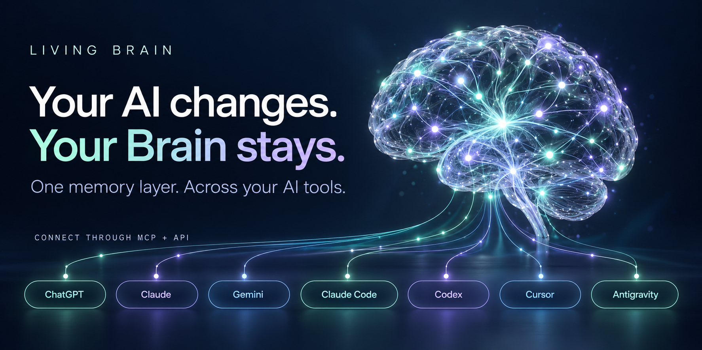
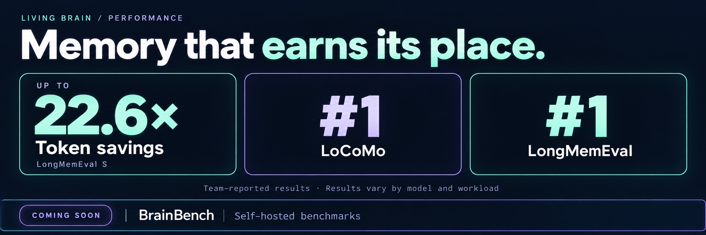

### One Living Brain. Across the AI tools you choose.

Imagine taking your memory from **ChatGPT to Claude to Gemini**—and bringing that same context into **Claude Code, Codex, Cursor, and Google Antigravity**.

**Living Brain is an interoperable, efficient memory layer for AI.** Connect through MCP or build with the API. Keep the context. Choose the model. Carry the work forward.

**🧠 Persistent memory · 🔌 MCP + API · ⚡ Up to 22.6× token savings on LongMemEval S\***

[Create your Living Brain →](https://docs.livingbrain.com/docs/quickstart) · [Connect with MCP →](https://docs.livingbrain.com/mcp) · [See reported results ↓](#memory-that-earns-its-place-in-your-context)

[Living Brain](#the-living-brain) · [Performance](#memory-that-earns-its-place-in-your-context) · [Developer guide](#build-with-living-brain) · [The ecosystem](#one-ecosystem-three-ways-in) · [Explore a scenario](#what-could-continuity-look-like) · [Open source](#agents-with-identity-and-ownership) · [Follow us](#stay-in-the-loop)

---

## The Living Brain

You have already explained the project. Made the decisions. Shared the context. That knowledge should keep working for you wherever you work next.

The **[Living Brain](https://livingbrain.com/)** gives AI a persistent memory layer that can travel across models and workflows. It also powers **[ChatChat](https://chatchat.com/)**, our messaging-first platform for proactive AI agents.

### Bring your Brain to the tools you use

**ChatGPT · Claude · Gemini · Claude Code · Codex · Cursor · Google Antigravity**

The idea is simple: choose the AI experience you want, and connect your Living Brain through the client's supported MCP or API integration. Your memory becomes a resource you can bring into the workflow.

| How you want to work | Where to start |
| :--- | :--- |
| **Connect through MCP with sign-in** | Follow the [MCP guide](https://docs.livingbrain.com/mcp) for connection and authentication instructions. |
| **Use MCP with API credentials** | Follow the [MCP guide](https://docs.livingbrain.com/mcp) for API-based access. |
| **Build memory into your own application** | Start with the [Quickstart](https://docs.livingbrain.com/docs/quickstart) and [TypeScript SDK](https://docs.livingbrain.com/sdk/typescript). |
| **Work from your terminal** | Explore the [Living Brain CLI](https://docs.livingbrain.com/cli). |

Connection options depend on the host application's support. See the [MCP documentation](https://docs.livingbrain.com/mcp) for setup details.

### Create a Brain for what matters to you

A project. A research topic. Your team's knowledge. Your next big idea.

Create a Living Brain around the context you want to carry forward, then bring it into your AI workflows. **Proprietary memory scoring** is central to how Living Brain approaches useful, efficient memory.

| Capability | Why it matters |
| :--- | :--- |
| **Interoperable memory** | Bring persistent context into different AI tools through MCP and API integrations. |
| **Proprietary memory scoring** | A dedicated approach to scoring memory, built into the Living Brain memory layer. |
| **Connected context** | Connect people, information, events, and goals. |
| **Continuity across work** | Carry relevant knowledge beyond a single conversation. |
| **Developer access** | Work through MCP, the API, the TypeScript SDK, or the CLI. |

## Memory that earns its place in your context

### Up to 22.6× token savings on LongMemEval S\*

Long-running work needs memory that is useful **and** efficient. Living Brain's focus is to carry relevant context forward while reducing the token burden of long-context workflows.

| Team-reported result | Evaluation |
| :--- | :--- |
| **Up to 22.6× token savings** | Long-context evaluation using **LongMemEval S**. |
| **#1 on LoCoMo** | Ranking reported by the Living Brain team. |
| **#1 on LongMemEval** | Ranking reported by the Living Brain team. |

\*These are team-reported results. Public result links, the ranking's comparison set, and the token-savings baseline and configuration are needed to independently assess them. Results can vary by model and workload.

**Coming soon: BrainBench, our self-hosted benchmark suite.** Put Living Brain to the test in your own environment.

## Build with Living Brain

**Create a Brain. Connect your tools. Start building with memory.**

| Your starting point | Official documentation |
| :--- | :--- |
| **Create your first Living Brain** | [Quickstart →](https://docs.livingbrain.com/docs/quickstart) |
| **Connect through MCP** | [MCP, sign-in, and API access →](https://docs.livingbrain.com/mcp) |
| **Explore workspace search** | [Search Pages API reference →](https://docs.livingbrain.com/api-reference/workspace/search-pages) |
| **Build with TypeScript** | [TypeScript SDK →](https://docs.livingbrain.com/sdk/typescript) |
| **Work from the command line** | [CLI →](https://docs.livingbrain.com/cli) |

[Browse all Living Brain documentation →](https://docs.livingbrain.com/)

## One ecosystem. Three ways in.

| | Role | Explore |
| :--- | :--- | :--- |
| 🧠 **Living Brain** | The memory and context infrastructure powering ChatChat. | [Explore Living Brain →](https://livingbrain.com/) |
| 💬 **ChatChat** | A messaging-first platform for creating and working with proactive AI agents, bringing conversations, knowledge, tools, and memory together. | [Discover ChatChat →](https://chatchat.com/) |
| 🛠️ **ChatAndBuild** | Create applications through natural conversation. The company behind this ecosystem. | [Start building →](https://chatandbuild.com/) |

**Our belief: anyone can chat and build.** Our mission is to make advanced intelligence more accessible, practical, and empowering.

## What could continuity look like?

Explore the possibilities. These scenarios illustrate the workflows we are building towards; connection details depend on your chosen tools.

<strong>💬 Plan in ChatGPT. Pick up the idea in Claude. Explore it with Gemini.</strong>

Imagine connecting the same Living Brain as you move between AI tools. The project brief, decisions, and relevant knowledge become context you can bring to the next conversation.

**Choose the model for the task. Keep your Brain with you.**

[Explore MCP connections →](https://docs.livingbrain.com/mcp)

<strong>⌨️ Bring project memory into Claude Code, Codex, Cursor, or Antigravity.</strong>

Your project has a history: requirements, architectural decisions, constraints, and lessons learned. Imagine bringing that context into your coding workflow through a connected Living Brain.

**Give your next coding session a head start.**

[Connect through MCP →](https://docs.livingbrain.com/mcp) · [Explore the CLI →](https://docs.livingbrain.com/cli)

<strong>🛠️ Build your own application with a Living Brain.</strong>

Choose your model and build a workflow around persistent memory. Start with the Quickstart, explore the TypeScript SDK, and consult the Search Pages API reference for workspace search.

**Your application. Your choice of model. A Brain to carry context forward.**

[Quickstart →](https://docs.livingbrain.com/docs/quickstart) · [TypeScript SDK →](https://docs.livingbrain.com/sdk/typescript) · [Search Pages API →](https://docs.livingbrain.com/api-reference/workspace/search-pages)

## Agents with identity and ownership

Memory is one part of continuity. Identity and ownership are another.

**Non-Fungible Agents** began as a framework for bringing identity, ownership, memory, and continuity to autonomous AI agents. The project is open source and formalised through **BAP-578**, a standard for intelligent digital entities with autonomous capabilities and verifiable ownership.

- [Explore the Non-Fungible Agents repository →](https://github.com/ChatAndBuild/non-fungible-agents-BAP-578)
- [Read the BAP-578 specification →](https://github.com/bnb-chain/BEPs/blob/master/BAPs/BAP-578.md)
- [Browse our public repositories →](https://github.com/orgs/ChatAndBuild/repositories)

For setup, licensing, contribution guidance, and security reporting, consult the relevant repository.

## Read the customer stories

Explore the published stories about ChatAndBuild:

- [Claude / Anthropic →](https://claude.com/customers/chatandbuild)
- [Google Cloud →](https://cloud.google.com/customers/chatandbuild)

## Stay in the loop

We welcome builders, researchers, founders, and partners exploring what persistent intelligence can make possible.

---

**Choose your AI. Bring your Brain. Keep building.**

[Explore the Living Brain →](https://livingbrain.com/) · [Start with the Quickstart →](https://docs.livingbrain.com/docs/quickstart)

